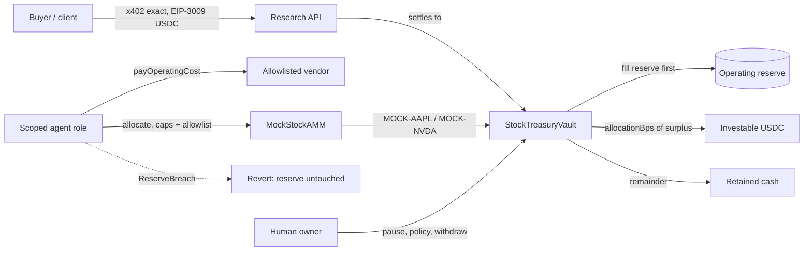

# StockTreasury Agent

An on-chain policy vault for an AI agent that **earns USDC and may invest only a user-set share of its surplus** into tokenized (here: clearly labeled mock) stocks.

The agent sells a research API, gets paid in USDC via **x402** (EIP-3009), then a Base contract:

1. Fills an **operating reserve the agent cannot invest**.
2. Pays operating costs from non-reserve cash.
3. Invests `allocationBps` of the remaining surplus through an allowlisted router into allowlisted stock tokens, inside per-tx and daily caps.
4. Reverts `ReserveBreach` if any agent call would take USDC below the reserve floor.

This is a **Base Stocks Maxxing Track 2.1** entry — *Agents that earn their stock treasury*.

**Show us:** a real payment funding a permitted stock purchase, with clear allocation rules and a reserve the agent can't invest.

**Network:** Base Sepolia (`84532`) and/or local Anvil. **There is no mainnet deploy.** Official Coinbase tokenized stocks are Base mainnet only (the public Tokenized Stocks API lists chain `8453` only); this repo uses **MOCK** stock tokens and a **MOCK** AMM and says so on every name, event, and page.

**License:** MIT.

## Do X → see Y

| What you do | What you see |
| --- | --- |
| `./scripts/test.sh` | 32 unit tests + 256-run invariant suite, including reserve-breach rejection |
| `./scripts/demo.sh` | Anvil deploy, an x402 research payment of 150 USDC into the vault, a 10 USDC operating cost, a 40 USDC MOCK-AAPL purchase (4 tokens at $10), and a reserve-drain attempt that reverts `ReserveBreach` |
| Open `tools/web/index.html` | Dashboard: reserve / retained / investable split, holdings, rejection log |
| `GET /research?ticker=MOCK-AAPL` with no payment | HTTP **402** and x402 PaymentRequirements (`payTo` = vault, asset = USDC) |
| Retry with a signed `X-PAYMENT` | EIP-3009 `transferWithAuthorization` settles USDC into the vault; you get the brief |

Default policy used in the demo (owner-set, agent cannot change it):

- Operating reserve: **50 USDC**
- Allocation: **70%** of surplus is investable; **30%** is retained cash the agent cannot invest
- Per-tx cap: **40 USDC**
- Daily cap: **80 USDC**

After a 150 USDC payment: reserve 50, investable 70, retained 30. A 10 USDC cost comes out of retained. A 40 USDC allocate leaves reserve 50, investable 30, retained 20, and 4 MOCK-AAPL in the vault.

## Live on Base Sepolia

These are real transactions, not fixtures. Full table: [docs/TESTNET.md](docs/TESTNET.md).

**Vault:** [`0xc6a9c24316DF6305a2CA994C70e33E22eF1238AE`](https://sepolia.basescan.org/address/0xc6a9c24316DF6305a2CA994C70e33E22eF1238AE)

| What you do | What you see | Explorer |
| --- | --- | --- |
| x402 payment of 150 USDC (EIP-3009) into the vault | HTTP 402, then a settled brief | [tx](https://sepolia.basescan.org/tx/0x668fc1435496a3d1c5676f25a1e1f4a6d978d9e9205dea57aeab417c6eb64ec7) |
| `syncRevenue` | Reserve 50, investable 70, retained 30 | [tx](https://sepolia.basescan.org/tx/0xac17b2dffa5bac27e4028de7d000642af04b480d97fb5bbd45971304f9f0727e) |
| Operating cost 10 USDC | Retained 20, reserve untouched | [tx](https://sepolia.basescan.org/tx/0x8ad63ce26e5699bed555222782fcc77d50ec06c72c8c495c17b76e0a697da927) |
| Allocate 40 USDC to MOCK-AAPL | 4 MOCK-AAPL; vault USDC 100 | [tx](https://sepolia.basescan.org/tx/0x0a890f36482acfc01cbdd535ee40a6aa94c267d92ab5b6dd2a404cdfd299c2de) |
| Agent tries to spend the reserve | **status 0, `ReserveBreach`**, USDC still 100 | [tx](https://sepolia.basescan.org/tx/0x2cf00ca154dee4d76f565d134c0b857feaddc665fc7494df384331083da0b448) |

The dashboard snapshot in `tools/web/snapshot.json` is from this run.


## Architecture



The policy lives in the contract, not in the model's instructions. A prompt that says "invest the reserve" still reverts.

## What's real, what's mock (honest scope)

| Piece | Status |
| --- | --- |
| Policy vault (reserve, split, caps, allowlist, kill-switch, scoped agent) | Real Solidity, Foundry-tested, including an invariant that the agent cannot breach the reserve (128,000 handler calls) |
| x402 payment | Real EIP-3009 settlement against MockUSDC (local) or Circle USDC on Base Sepolia (`0x036CbD53842c5426634e7929541eC2318f3dCF7e`) if the wallet is funded |
| Research service | Real HTTP 402 / X-PAYMENT flow; briefs are canned MOCK research, optionally annotated with public Coinbase mainnet metadata |
| Stock tokens and AMM | **MOCK, clearly labeled.** Not securities. Not Coinbase-issued. No rights in any public company. Fixed demo prices, not a market |
| Official tokenized stocks on Base Sepolia | **Do not exist** (API `/chains` returns only `8453`) |
| Mainnet | **Out of scope. Never deployed.** |

## Repository layout

```
src/StockTreasuryVault.sol     Policy vault
src/mocks/                     MockUSDC (EIP-3009), MockStockToken, MockStockAMM
test/                          Unit tests + invariant tests
script/                        Local and Base Sepolia deploys
tools/service/server.py        x402 research API
tools/agent/run.py             Agent loop: pay → sync → cost → allocate → reject
tools/web/                     Static dashboard (GitHub Pages ready)
scripts/demo.sh                One-command local demo
scripts/deploy-sepolia.sh      Base Sepolia only (chain-id gated)
scripts/bridge-sepolia-eth.sh  Official L1 Standard Bridge, ~0.2 ETH, Sepolia only
```

## Quick start (local)

Requires Foundry (`forge`, `anvil`, `cast`) and Python 3 with `web3` and `eth-account`.

```bash
./scripts/test.sh
./scripts/demo.sh
./scripts/ui.sh          # http://127.0.0.1:8788
```

## Base Sepolia

Deploy is gated to chain id **84532**. The script reads `QDAY_PRIVATE_KEY` from the environment inside Forge (`vm.envUint`) and never prints it.

```bash
# 1. Get Base Sepolia ETH via an official faucet
#    https://docs.base.org/base-chain/network-information/network-faucets
#    or the official L1 Standard Bridge from Ethereum Sepolia:
#    0xfd0Bf71F60660E2f608ed56e1659C450eB113120
./scripts/bridge-sepolia-eth.sh          # optional, ~0.2 ETH

# 2. Optional official Circle USDC (Circle faucet, Base Sepolia).
#    If you have some:  USE_CIRCLE_USDC=true
#    Otherwise DeploySepolia mints labeled MockUSDC.

# 3. Deploy (refuses any chain other than 84532)
./scripts/deploy-sepolia.sh
```

Addresses and transaction hashes are written to `deployments/base-sepolia.json`. This README will not invent hashes; if a testnet deploy is not in that file, it has not happened.

## Policy surface (for reviewers)

- `setPolicy(allocationBps, operatingReserveTarget, perTxCap, dailyCap)` — owner only
- `setStockAllowed` / `setRouter` / `setCostRecipient` — owner only
- `pause` / `unpause` — owner kill-switch
- `ownerWithdraw` — **only** path that can move the reserve or stock holdings out
- `deposit` / `syncRevenue` — anyone; x402 settlements are direct USDC transfers, then `syncRevenue`
- `allocate(stock, amount, minOut)` — agent only; allowlist + caps + `ReserveBreach`
- `payOperatingCost(to, amount, reason)` — agent only; retained cash first, then investable, never reserve

Custom errors judges will see: `ReserveBreach`, `ExceedsInvestable`, `PerTxCapExceeded`, `DailyCapExceeded`, `StockNotAllowed`, `Paused`, `NotAgent`.

## Disclaimers

- Competition prototype, testnet only. Not a brokerage, not a production agent wallet, not investment, legal, or tax advice.
- Mock stock tokens are **not** securities and are **not** affiliated with Apple, NVIDIA, Coinbase, or any issuer.
- The Quest Page FAQ states that projects which enable trading for US users are not eligible. This demo does not offer trading to any user population.
- No relationship with or endorsement by Coinbase, Base, or any launchpad partner is claimed.
- See also [docs/SCOPE.md](docs/SCOPE.md), [docs/VIDEO_SCRIPT.md](docs/VIDEO_SCRIPT.md), and the research notes at `../RULES.md`.
